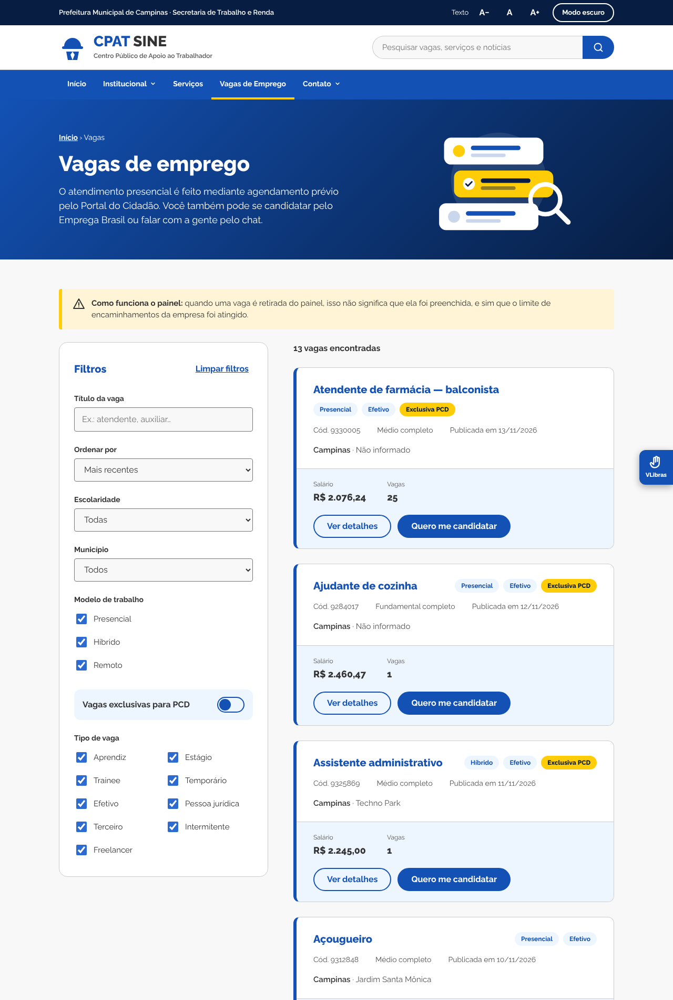

# Design System

Parte do Gov.br Design System (GovDS) e define um Design System próprio do CPAT por cima, com tokens claros e escuros.

## Tokens

| Token | Claro | Escuro | Uso |
| --- | --- | --- | --- |
| Primária | #1351B4 | #2D6BD1 (botões), #9DBFF7 (texto) | Ações, títulos, links |
| Azul profundo | #071D41 | #060C18 | Rodapé e hero |
| Destaque | #FFCD07 | #FFCD07 | Foco, selo PCD, atenção |
| Fundo | #F8F8F8 | #0B1424 | Página |
| Superfície | #FFFFFF | #14223A | Cards e painéis |
| Borda de campo | #767676 | #8397B8 | Inputs e checkboxes |

Fonte: Rawline no GovDS; o protótipo usa Raleway como substituta. A escala de texto aceita de −2 a +4 passos (A−/A+).

## Princípios aplicados

- **Hierarquia visual:** título, dados e ação em níveis distintos.
- **Alinhamento e grid:** contêiner de 1120 px, margens de 32 px.
- **Consistência:** mesmos botões em pílula, raios e cores de estado.
- **Espaço em branco:** 28 px entre cards de vaga, 48 px entre filtros e resultados.
- **Gestalt:** proximidade, similaridade, região comum, figura e fundo, continuidade, fechamento e prägnanz.
- **Design atômico:** átomos, moléculas, organismos, templates e páginas.

## Telas do protótipo

| Home | Home (escuro) |
| --- | --- |
|  |  |

| Vagas | Serviços |
| --- | --- |
|  |  |

Arquivos editáveis: [mockups/redesign-govbr](https://github.com/Paul0Ant0ni0/cpat-digital/tree/main/mockups/redesign-govbr)
