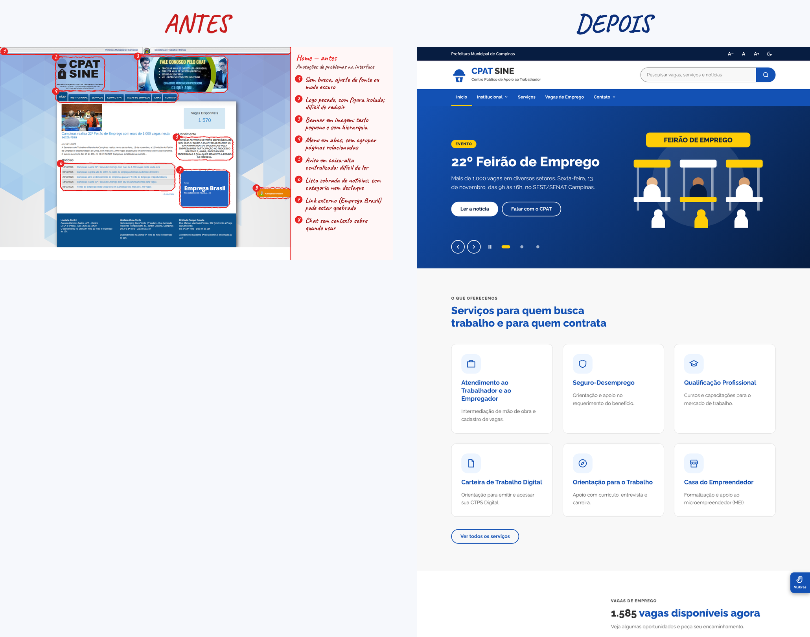

# CPAT Campinas — Wiki

Projeto de modernização digital do **CPAT Campinas** (Centro Público de Apoio ao Trabalhador, da Secretaria Municipal de Trabalho e Renda): identidade visual, design UI/UX, protótipos e uma plataforma digital para aproximar trabalhadores das oportunidades de emprego.

## Por onde começar

| Quero... | Vá para |
| --- | --- |
| Entender o problema e a solução | [Sobre o projeto](Sobre-o-projeto) |
| Ver quem usa o site | [Personas](Personas) |
| Ver o que o site deve fazer | [Requisitos](Requisitos) |
| Ver o design | [Design System](Design-System) e [Identidade visual](Identidade-visual) |
| Entender a arquitetura | [Stack e arquitetura](Stack-e-arquitetura) |
| Rodar o projeto | [Guia de desenvolvimento](Guia-de-desenvolvimento) |
| Saber como trabalhamos | [Convenções](Convencoes) |
| Ver o que vem pela frente | [Roadmap](Roadmap) |

Repositório: https://github.com/Paul0Ant0ni0/cpat-digital · Issues: https://github.com/Paul0Ant0ni0/cpat-digital/issues
