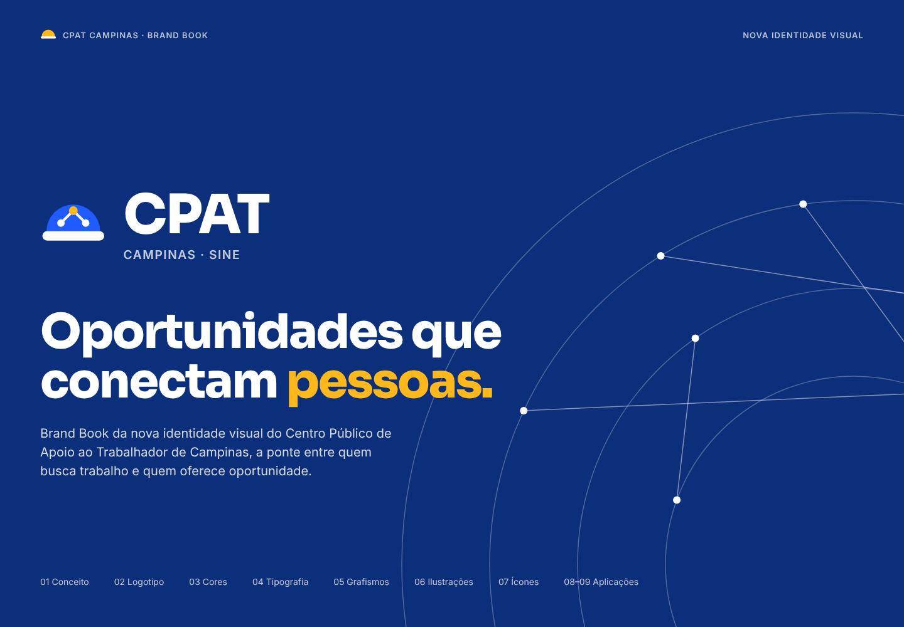
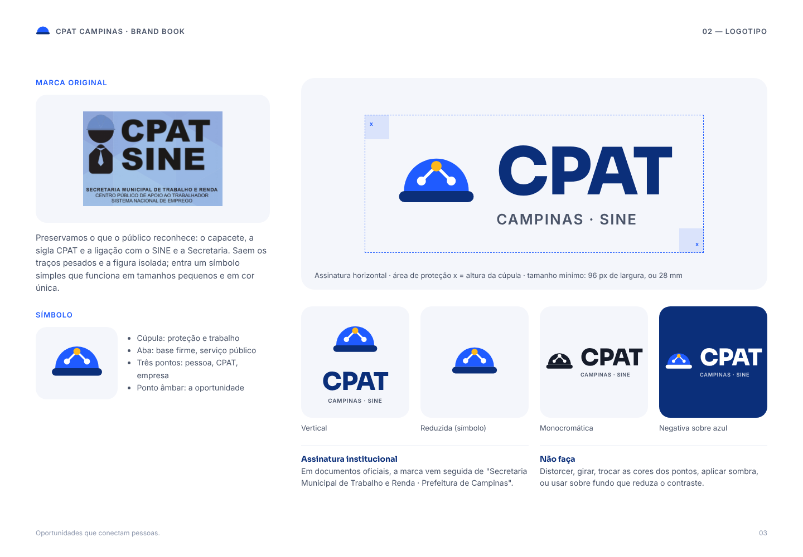

# Identidade visual

Conceito: **"Oportunidades que conectam pessoas."** Detalhes em [docs/identidade-visual.md](https://github.com/Paul0Ant0ni0/cpat-digital/blob/main/docs/identidade-visual.md).

## Cores

| Cor | HEX | Uso |
| --- | --- | --- |
| Azul Campinas | #0B2F7A | Institucional |
| Azul Conexão | #1F5BFF | Ações e destaques |
| Grafite | #161C2A | Texto principal |
| Âmbar | #FFB81C | Um ponto de destaque por peça |
| Branco | #FFFFFF | Fundo predominante |
| Névoa | #F4F6FB | Fundos de apoio |

## Tipografia

Sora (títulos, pesos 700 e 800) e Inter (texto e interface, pesos 400 e 500).

## Logotipo

Cúpula azul com aba e três pontos ligados (pessoa, CPAT e empresa), com um ponto âmbar para a oportunidade. Versões em [assets/logo](https://github.com/Paul0Ant0ni0/cpat-digital/tree/main/assets/logo).

