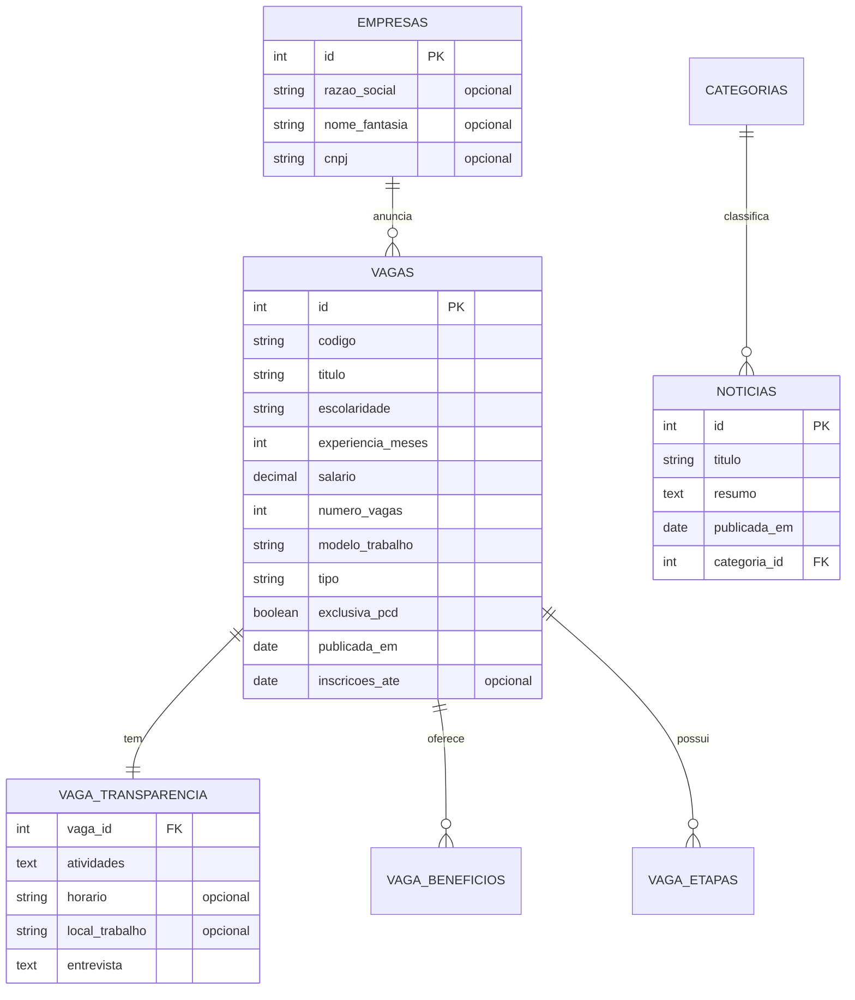

# Modelo de dados

Rascunho do modelo (será detalhado na issue de UML). Base para o `db.json` do JSON Server e para a v2 em PostgreSQL.

Outras tabelas previstas: `servicos`, `faq`, `depoimentos`, `unidades` e `contatos` (SAC e Ouvidoria).
