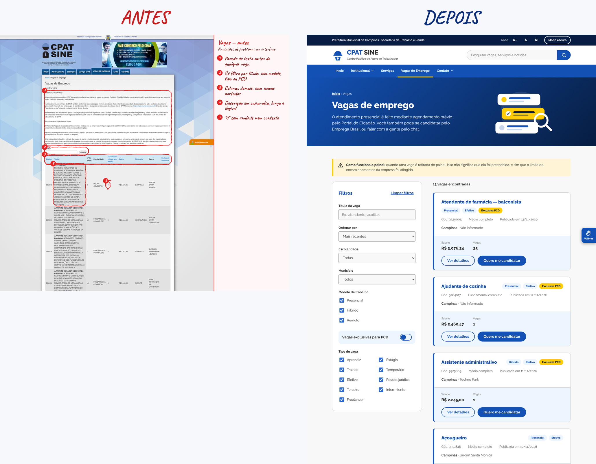

# Sobre o projeto

## Problema

O site atual do CPAT Campinas (https://cpat.campinas.sp.gov.br/) é antigo, pouco funcional e não atende critérios de acessibilidade, o que dificulta o acesso do trabalhador aos serviços de emprego e renda da Prefeitura.

- Interface desatualizada, sem padrão visual do governo e sem hierarquia de informação.
- Navegação e busca pouco funcionais; sem FAQ, SAC, Ouvidoria ou chat integrados.
- Acessibilidade insuficiente: sem ajuste de fonte, sem modo escuro, contraste e foco de teclado não tratados.
- Lista de vagas sem filtros úteis.
- Experiência fraca em celular.
- Sem prova social (depoimentos).

## Objetivo

Entregar um site moderno, acessível e funcional, que ajude o cidadão a encontrar vagas, entender os serviços e falar com a Prefeitura sem sair da página.

- Seguir o Gov.br Design System (GovDS).
- Cumprir WCAG 2.1 AA e eMAG.
- Facilitar a busca de vagas com filtros combináveis.
- Abrir canais de atendimento: chat, FAQ, SAC e Ouvidoria.
- Funcionar bem em desktop e celular.

## Solução

Cinco telas prototipadas em versões clara e escura, versão mobile e um Design System próprio: Home, Vagas de emprego, Serviços, Institucional e Atendimento.

## Escopo da v1

**Dentro:** front-end em Angular e Tailwind CSS com dados de exemplo (JSON Server), modo escuro, A−/A+, VLibras, filtros de vagas, chat JivoChat, formulários de SAC e Ouvidoria sem envio real, SEO e tratamento de links quebrados.

**Fora (v2):** back-end e API reais, envio real de SAC e Ouvidoria, integração com o Emprega Brasil, painel administrativo ou CMS.

Documento completo: [docs/briefing.md](https://github.com/Paul0Ant0ni0/cpat-digital/blob/main/docs/briefing.md)
